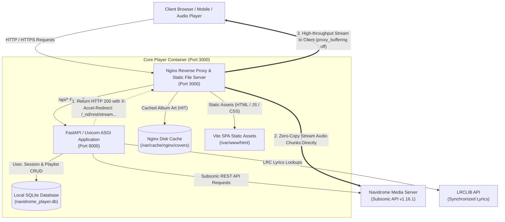
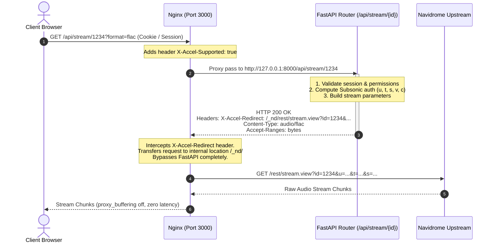
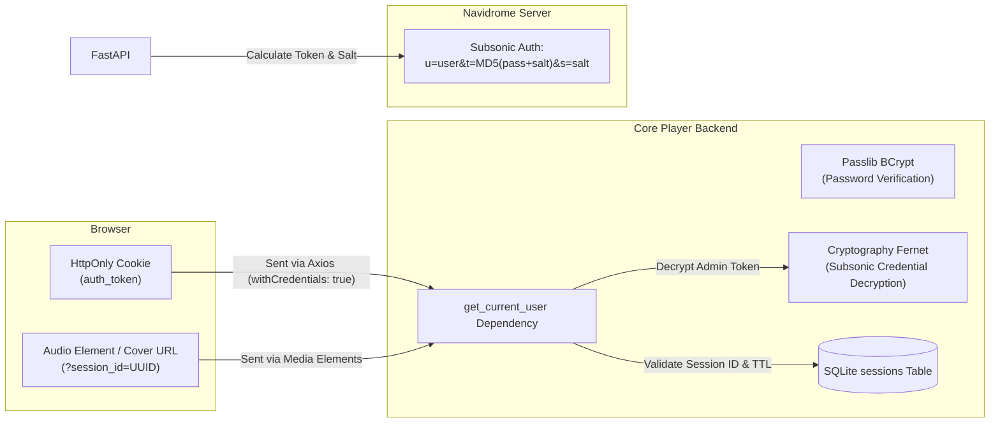
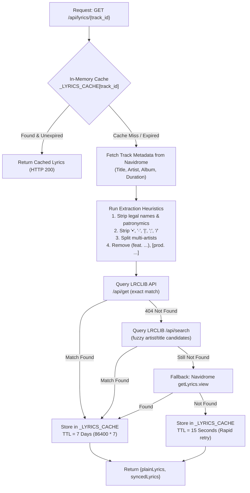

# System Architecture & Design Specification

This document provides a comprehensive architectural breakdown of **Core Music Player**, covering container runtime topology, the high-performance zero-copy audio pipeline, dual-mode seek mechanisms, caching strategies, and security design.

---

## 1. High-Level System Architecture

Core Music Player operates as a unified multi-tier streaming service. The system combines an edge Nginx reverse proxy with a high-performance Python ASGI backend (FastAPI) and an Apple-inspired reactive single-page frontend (React 19). Media files, collection metadata, and transcoded streams are powered by an upstream [Navidrome](https://www.navidrome.org/) music server implementing the Subsonic API.

---

## 2. Nginx Edge Acceleration & Zero-Copy Streaming

One of the foundational architectural tenets of Core Music Player is **zero-copy streaming**. High-bitrate audio streaming (such as FLAC 24-bit 96kHz or ALAC) places significant strain on Python's asynchronous event loop (`asyncio`) if piped chunk-by-chunk through memory. 

To eliminate CPU bottlenecks and memory pressure, Core Music Player delegates raw stream delivery to **Nginx `X-Accel-Redirect`**.

### The `X-Accel-Redirect` Handshake

### Key Nginx Directives in [`docker/nginx.conf`](file:///Users/skenls/webplayer/docker/nginx.conf)

1. **`sendfile on; tcp_nopush on; tcp_nodelay on;`**:
   Activates OS-level zero-copy socket transfers, sending packet headers and audio payloads in full network packets without artificial Nagle delays.
2. **`location /_nd/ { internal; ... }`**:
   Designated as `internal`, preventing external clients from forging direct requests to this path. Can only be reached through an upstream `X-Accel-Redirect` response emitted by FastAPI.
3. **`proxy_buffering off;`**:
   Disabled both in `location /api/` and `location /_nd/`. Prevents Nginx from holding audio frames in 128KB/256KB buffer pages before flushing to the client, guaranteeing instant playback onset for web browsers and mobile clients.
4. **`proxy_cache covers_cache;`**:
   Configured in `location /api/stream/cover/` using a 500MB on-disk LRU cache (`/var/cache/nginx/covers`). Responses from Navidrome are cached for `30d` with stale cache recovery (`proxy_cache_use_stale error timeout updating http_500 http_502`).
5. **`limit_req_zone $binary_remote_addr zone=login_limit:10m rate=10r/m;`**:
   Protects the `/api/auth/login` endpoint against brute-force password guessing by enforcing an IP rate limit of 10 requests per minute with a burst tolerance of 5.

---

## 3. Dual-Mode Audio Streaming & Seeking Architecture

Audio seeking in web applications is fundamentally constrained by container encoding formats. When streaming raw or native files, HTTP Range requests work effortlessly; however, when transcoding on-the-fly (e.g., FLAC to AAC or Opus), FFmpeg cannot reliably calculate exact byte positions for future timestamps.

Core Music Player implements a **Dual-Mode Seek Engine** coordinated between backend [`backend/app/routers/stream.py`](file:///Users/skenls/webplayer/backend/app/routers/stream.py) and frontend [`frontend/src/lib/streamSeek.ts`](file:///Users/skenls/webplayer/frontend/src/lib/streamSeek.ts):

| Stream Characteristic | Mode A: Native Range 206 Seeking | Mode B: Transcoded Time-Offset Seeking |
| :--- | :--- | :--- |
| **Trigger Condition** | Format is `raw`, or requested format matches source file format (e.g. FLAC source playing as `flac`). | Format is transcoded on-the-fly (e.g. FLAC $\rightarrow$ AAC, MP3 $\rightarrow$ Opus). |
| **Seek Execution** | Native browser `HTMLAudioElement.currentTime = targetTime`. | Frontend reloads stream URL with query parameter `?timeOffset=seconds`. |
| **HTTP Protocol** | Standard `Range: bytes=start-end` $\rightarrow$ `206 Partial Content`. | `GET /api/stream/{id}?format=aac&timeOffset=45` $\rightarrow$ `200 OK`. |
| **Server Transcoder** | Direct stream without initial offset skipping. | FFmpeg invokes `-ss {timeOffset}` prior to input `-i` for instantaneous keyframe seek. |
| **Playback Continuity** | Browser audio element handles buffering smoothly. | [`audioService`](file:///Users/skenls/webplayer/frontend/src/lib/audioService.ts) tracks `baseTime = timeOffset` and reports elapsed time as `baseTime + audio.currentTime`. |

---

## 4. Security & Authentication Architecture

Authentication is stateless from the perspective of Navidrome, but stateful and strictly managed on the Core Player edge.

### 1. Multi-Channel Session Detection
Standard API calls automatically carry the `auth_token` HttpOnly cookie. However, standard browser `<audio>` tags and `` tags for artwork frequently cannot send custom authorization headers in cross-origin or proxy scenarios. Core Player's [`get_current_user`](file:///Users/skenls/webplayer/backend/app/dependencies.py) dependency checks for authentication in the following order:
1. `request.cookies.get("auth_token")`
2. `request.query_params.get("session_id")`
3. `request.headers.get("Authorization")` (`Bearer <token>`)

### 2. Password Hashing & Subsonic Token Calculation
- **User Passwords**: Stored as bcrypt hashes (`passlib.context.CryptContext(schemes=["bcrypt"])`). Plaintext passwords are never persisted.
- **Subsonic API Integration**: Authenticates against Navidrome using modern Subsonic token authentication:
  $$\text{token} = \text{MD5}(\text{navidrome\_pass} + \text{salt})$$
  Every outbound Subsonic request includes `u` (username), `t` (token), `s` (salt), `v=1.16.1` (protocol version), and `c=core-player` (client identifier).

---

## 5. Synchronized Lyrics Resolution Architecture

Karaoke-style synchronized lyrics are retrieved using a multi-stage heuristics engine interfacing with the external [LRCLIB API](https://lrclib.net/) and Navidrome's native OpenSubsonic lyrics endpoint.

---

## 6. Architecture & System Call Reference

The primary system calls and internal communication contracts between Core Player subsystems are summarized below:

| Operation | Calling Component | Target Component | Protocol / Mechanism | Description |
| :--- | :--- | :--- | :--- | :--- |
| **`authenticate_user()`** | [`auth.py`](file:///Users/skenls/webplayer/backend/app/routers/auth.py#L26) | [`database.py`](file:///Users/skenls/webplayer/backend/app/database.py) | Async SQLAlchemy | Verifies bcrypt password against SQLite `users` table; returns `User` model. |
| **`create_session()`** | [`auth.py`](file:///Users/skenls/webplayer/backend/app/routers/auth.py#L48) | [`models.py`](file:///Users/skenls/webplayer/backend/app/models.py#L21) | Async SQLAlchemy | Generates a cryptographically random UUIDv4 session with 30-day expiration. |
| **`get()`** | [`subsonic_client.py`](file:///Users/skenls/webplayer/backend/app/subsonic_client.py#L34) | Navidrome `/rest/*` | HTTP GET (HTTPX) | Executes an authenticated Subsonic query and unwraps the `subsonic-response` JSON envelope. |
| **`get_stream_proxy_path()`** | [`subsonic_client.py`](file:///Users/skenls/webplayer/backend/app/subsonic_client.py#L90) | [`stream.py`](file:///Users/skenls/webplayer/backend/app/routers/stream.py#L104) | Internal URI formatting | Produces internal path `/_nd/rest/{endpoint}?{auth_params}` for Nginx `X-Accel-Redirect`. |
| **`stream_audio()`** | [`stream.py`](file:///Users/skenls/webplayer/backend/app/routers/stream.py#L72) | Nginx / Navidrome | HTTP GET/HEAD | Validates user session, extracts seek parameters, and issues `X-Accel-Redirect` or fallback `StreamingResponse`. |
| **`fetch_lrclib_lyrics()`** | [`lyrics.py`](file:///Users/skenls/webplayer/backend/app/lyrics.py#L81) | LRCLIB Cloud API | HTTPS GET (HTTPX) | Performs multi-candidate search for synchronized LRC timestamps with retry and backoff. |
| **`seek()`** | [`audioService.ts`](file:///Users/skenls/webplayer/frontend/src/lib/audioService.ts#L50) | `HTMLAudioElement` | DOM API / URL mutation | Decides between native browser `currentTime` seek or URL reload with `?timeOffset=...`. |
| **`updateProgress()`** | [`useAudioEngine.ts`](file:///Users/skenls/webplayer/frontend/src/hooks/useAudioEngine.ts#L30) | [`playerStore.ts`](file:///Users/skenls/webplayer/frontend/src/store/playerStore.ts#L42) | Zustand Store Dispatch | Invoked on HTML5 `timeupdate` events to broadcast real-time audio progress to UI and lyrics. |
