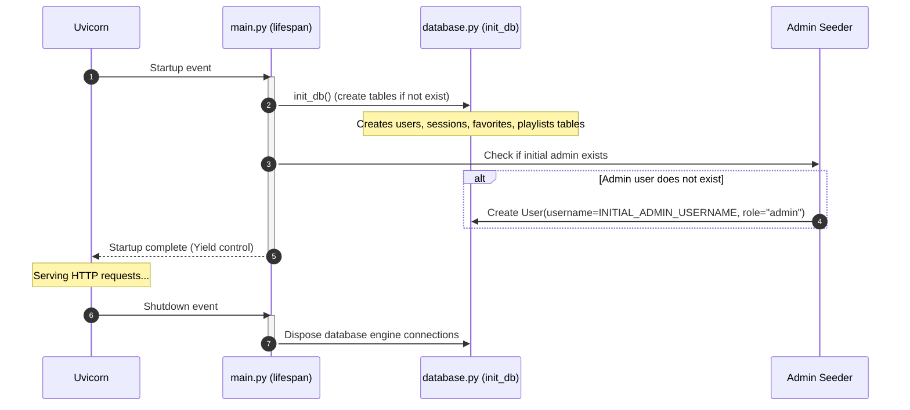
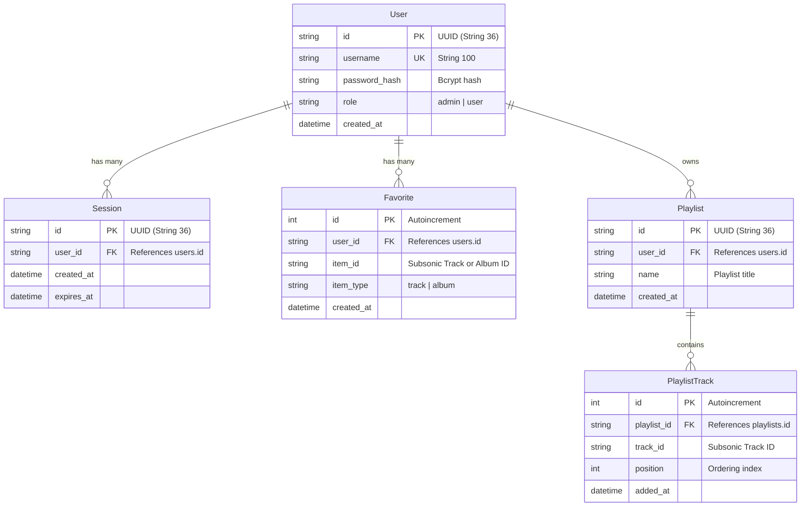

# Backend Engine & API Architecture

This document describes the design, implementation, and API surface of the **Core Music Player** backend service.

---

## 1. Backend Overview & Technology Stack

The backend is built with **FastAPI** running on the asynchronous **Uvicorn** ASGI server. It acts as a specialized reverse proxy, business logic coordinator, and persistence bridge between the frontend and the upstream Navidrome media server.

### Core Dependencies
- **[FastAPI](https://fastapi.tiangolo.com/)**: High-performance asynchronous web framework providing automatic OpenAPI documentation, dependency injection, and Pydantic v2 serialization.
- **[SQLAlchemy 2.0 (Async)](https://docs.sqlalchemy.org/) & [aiosqlite](https://github.com/omnilib/aiosqlite)**: Asynchronous ORM and SQLite database driver.
- **[HTTPX](https://www.python-httpx.org/)**: Asynchronous HTTP client utilizing connection pooling for Subsonic API and LRCLIB requests.
- **[Passlib](https://passlib.readthedocs.io/)**: Secure password hashing using `bcrypt`.
- **[Cryptography (Fernet)](https://cryptography.io/)**: AES-128 CBC symmetric encryption for sensitive configuration data.

---

## 2. Application Bootstrap & Lifecycle

The application lifecycle is managed via the FastAPI `lifespan` context manager in [`backend/app/main.py`](file:///Users/skenls/webplayer/backend/app/main.py):

### CORS Configuration
CORS middleware is registered in [`main.py`](file:///Users/skenls/webplayer/backend/app/main.py#L42-L50) to support local development alongside production reverse proxies:
- `allow_origins = settings.cors_origins_list`
- `allow_credentials = True`
- `allow_methods = ["*"]`
- `allow_headers = ["*"]`

---

## 3. Configuration Management

Application settings are parsed by [`backend/app/config.py`](file:///Users/skenls/webplayer/backend/app/config.py) using Pydantic's `BaseSettings`:

| Environment Variable | Type | Default Value | Description |
| :--- | :--- | :--- | :--- |
| `SECRET_KEY` | `str` | *(Required)* | Secret key for cryptographic signing. |
| `ENCRYPTION_KEY` | `str` | *(Required)* | 44-character Base64 Fernet symmetric encryption key. |
| `DATABASE_URL` | `str` | `sqlite+aiosqlite:///./navidrome_player.db` | Async SQLAlchemy SQLite database connection string. |
| `CORS_ORIGINS` | `str` | `http://localhost:3000` | Comma-separated list of allowed CORS origin URLs. |
| `SESSION_EXPIRE_DAYS` | `int` | `30` | Lifetime in days for client user sessions. |
| `NAVIDROME_URL` | `str` | `http://localhost:4533` | Internal or upstream URL to the Navidrome server. |
| `NAVIDROME_USER` | `str` | `skenls` | Admin username used to communicate with Navidrome. |
| `NAVIDROME_PASS` | `str` | `None` | Navidrome password used to derive Subsonic auth token and salt. |
| `INITIAL_ADMIN_USERNAME` | `str` | `admin` | Default username created during initial system bootstrap. |
| `INITIAL_ADMIN_PASSWORD` | `str` | `admin123` | Default password created during initial system bootstrap. |

---

## 4. Database Schema & ORM Models

Data persistence is handled by SQLite via asynchronous SQLAlchemy models defined in [`backend/app/models.py`](file:///Users/skenls/webplayer/backend/app/models.py):

### Table Definitions
1. **`users`**: Contains system user records, bcrypt-hashed credentials, and authorization roles (`admin` or `user`).
2. **`sessions`**: Stores active authentication tokens. The method `is_expired()` checks if `datetime.utcnow() > expires_at`. Expired sessions are lazily deleted upon inspection.
3. **`favorites`**: Tracks starred songs and albums with a unique constraint `uq_user_item_fav` on `(user_id, item_id, item_type)`.
4. **`playlists` & `playlist_tracks`**: Manages user-created playlists with support for position-based track reordering and cascading deletion (`ondelete="CASCADE"`).

---

## 5. Core Backend Subsystems

### 5.1 Subsonic Client (`SubsonicClient`)
Defined in [`backend/app/subsonic_client.py`](file:///Users/skenls/webplayer/backend/app/subsonic_client.py), this client manages asynchronous communication with Navidrome's Subsonic API endpoint (`/rest/*`):

- **Automatic Authentication Parameters**:
  Every request includes:
  - `u`: Username.
  - `t`: MD5 token generated via `md5(password + salt)`.
  - `s`: Cryptographically random 16-hex character salt.
  - `v`: Protocol version (`1.16.1`).
  - `c`: Client name (`core-player`).
  - `f`: Format (`json`).
- **Response Envelope Unwrapping**:
  The method `get(endpoint, **params)` extracts the inner JSON payload from Subsonic's standard `{"subsonic-response": {...}}` wrapper. If `status == "failed"`, it raises an `HTTPException` with the upstream error code and message.
- **Internal Nginx Path Generation**:
  `get_stream_proxy_path(endpoint, **params)` formats an internal acceleration path (`/_nd/rest/{endpoint}?{querystring}`) used directly by Nginx `X-Accel-Redirect`.

---

### 5.2 Audio Streaming Pipeline (`routers/stream.py`)
Audio streaming handles both direct and transcoded audio delivery via [`backend/app/routers/stream.py`](file:///Users/skenls/webplayer/backend/app/routers/stream.py):

- **Parameter Builder (`build_stream_params`)**:
  Located in [`backend/app/stream_params.py`](file:///Users/skenls/webplayer/backend/app/stream_params.py):
  - Sets `maxBitRate="0"` automatically for `format=flac` to preserve lossless stream quality without artificial compression caps.
  - Forwards `timeOffset` as an integer (`max(0, int(timeOffset))`) to instruct Navidrome's FFmpeg pipeline to fast-seek to a specific playback point.
  - Omits `estimateContentLength` by default to avoid Go `net/http` stream truncation panics on variable-bitrate streams.
- **MIME Types Supported**:
  - `mp3`: `audio/mpeg`
  - `opus`: `audio/ogg`
  - `ogg`: `audio/ogg`
  - `flac`: `audio/flac`
  - `aac`: `audio/aac`
  - `raw`: `audio/mpeg` (streams native source file untouched)
- **Zero-Copy Delivery (`X-Accel-Redirect`)**:
  When `request.headers.get("x-accel-supported") == "true"`, the router returns an empty body `Response(status_code=200)` with:
  - `X-Accel-Redirect: /_nd/rest/stream.view?...`
  - `Accept-Ranges: bytes`
  - `Content-Type: <mime-type>`
- **Local Fallback Streaming**:
  When running outside Nginx, the router invokes `client.stream_raw()`, forwarding `Range` headers and streaming byte chunks via `StreamingResponse(chunk_size=65536)` with guaranteed resource cleanup (`response.aclose()`).

---

### 5.3 Metadata Cleansing & Library Aggregation (`routers/library.py`)
Located in [`backend/app/routers/library.py`](file:///Users/skenls/webplayer/backend/app/routers/library.py):

#### Legal Name (FIO / Patronymic) Detection
Modern streaming services frequently inject composers, publishers, and legal person names into the artist metadata field (e.g. `Kai Angel • Ицков Дмитрий Олегович`). The function `is_fio(name)` filters these out using regex heuristics:
1. **Patronymic Endings**: Matches Cyrillic and Latin patronymics (`-ович`, `-евич`, `-овна`, `-евна`, `-ovich`, `-evich`, `-ovna`, `-ivna`).
2. **Initials**: Matches abbreviation patterns (e.g. `D. O.`, `И. И.`).
3. **Common First Name + Slavic Surname**: Cross-references common given names (`Александр`, `Дмитрий`, `Сергей`, etc.) with typical surname endings (`-ов`, `-ев`, `-ин`, `-ский`, `-енко`, etc.).

#### Artist Splitting & Collaboration Resolution
`split_artist_names(artist_name)` splits compound artist tags by `,`, `&`, `feat.`, `ft.`, `featuring`, `with`, `x`, and `/`, discarding any individual token identified as a legal name.

#### Infinite Batch Pagination Looping
Navidrome enforces a hard limit of 500 items per request for `/rest/getAlbumList2` and `/rest/search3`. The endpoints `GET /api/library/albums` and `GET /api/library/tracks` support `all=true` or `size=0`:
- Initiates an asynchronous loop fetching chunks of 500 records (`offset += 500`).
- Aggregates all returned records in memory until a chunk returns fewer than 500 items.
- Returns the complete library collection in a single unified JSON payload.

---

### 5.4 Lyrics Engine (`lyrics.py`)
Located in [`backend/app/lyrics.py`](file:///Users/skenls/webplayer/backend/app/lyrics.py):

- **In-Memory Cache (`_LYRICS_CACHE`)**:
  Maps `track_id` to `(timestamp, result_dict)`.
  - Found lyrics (`syncedLyrics` or `plainLyrics`) are cached for **7 days** (`CACHE_TTL_SUCCESS = 86400 * 7`).
  - Missing/empty results are cached for **15 seconds** (`CACHE_TTL_EMPTY = 15`) to prevent rate-limiting while allowing rapid retries after metadata edits.
- **Candidate Normalization (`extract_artist_candidates` & `extract_title_candidates`)**:
  - Cleans bullet points (`•`, `·`, `|`, `;`, `/`).
  - Strips parenthetical noise such as `(feat. ...)`, `[prod. ...]`, `(Official Video)`.
  - Generates permutations: Primary artist only, Full compound artist, Ampersand variation (`A & B`).
- **LRCLIB Integration & Rate Limit Handling**:
  - Issues exact queries to `https://lrclib.net/api/get`.
  - On failure, queries `https://lrclib.net/api/search` with candidate permutations.
  - Polite `User-Agent: CorePlayer/1.0` header.
  - Implements exponential backoff on HTTP 429 (Too Many Requests).
- **OpenSubsonic Fallback**:
  If LRCLIB returns no matches, falls back to Navidrome's native `getLyrics.view` Subsonic endpoint.

---

## 6. Complete REST API Reference

### 6.1 Authentication Endpoints (`/api/auth`)

| Method | Endpoint | Query / Body Parameters | Auth | Response | Description |
| :--- | :--- | :--- | :--- | :--- | :--- |
| `POST` | `/api/auth/login` | **Body**: `{ "username": "...", "password": "..." }` | Public (Rate-limited) | `AuthResponse` + Set-Cookie | Verifies credentials, generates UUID session, sets `auth_token` HttpOnly cookie. |
| `GET` | `/api/auth/me` | None | Session | `AuthResponse` | Returns currently authenticated user ID, username, role, and `session_id`. |
| `POST` | `/api/auth/logout` | None | Session | `{ "success": true }` | Deletes current session from SQLite and clears `auth_token` cookie. |

---

### 6.2 Audio Streaming & Assets (`/api/stream`)

| Method | Endpoint | Query Parameters | Auth | Response | Description |
| :--- | :--- | :--- | :--- | :--- | :--- |
| `GET`, `HEAD` | `/api/stream/{track_id}` | `format` (`mp3|opus|flac|aac|raw`) `maxBitRate` (`int`) `timeOffset` (`int`) `session_id` (`str`, optional) | Session | Audio Stream (`200` or `206`) | Streams audio with `X-Accel-Redirect` or fallback chunked generator. |
| `GET`, `HEAD` | `/api/stream/cover/{cover_id}` | `size` (`int`, default `300`) `session_id` (`str`, optional) | Session | Image (`image/jpeg`) | Delivers album artwork with 30-day disk caching header. |
| `POST` | `/api/stream/custom-background` | **Multipart Form**: `file` (JPEG, PNG, WebP $\le$ 15MB) | User | `{ "url": "/api/stream/custom-background?t=..." }` | Validates image magic bytes and saves wallpaper to server disk. |
| `GET` | `/api/stream/custom-background` | None | Public | Image (`image/jpeg`) | Serves saved custom wallpaper with 24-hour cache header. |

---

### 6.3 Music Library & Playlists (`/api/library`)

| Method | Endpoint | Query / Body Parameters | Auth | Description |
| :--- | :--- | :--- | :--- | :--- |
| `GET` | `/api/library/albums` | `type` (`newest|recent|random|alphabeticalByName`) `size` (`int`, default `50`) `all` (`bool`, default `false`) | User | Retrieves album listing with automatic batch-loop pagination when `all=true`. |
| `GET` | `/api/library/albums/all` | None | User | Shortcut to fetch the entire album library sorted alphabetically. |
| `GET` | `/api/library/albums/{album_id}` | Path: `album_id` | User | Detailed album information including full tracklist. |
| `GET` | `/api/library/artists` | None | User | Retrieves all artists with legal name filtering. |
| `GET` | `/api/library/artists/{artist_id}` | Path: `artist_id` | User | Artist details, biography, and discography. |
| `GET` | `/api/library/tracks` | `all` (`bool`) `size` (`int`) `offset` (`int`) | User | Retrieves song library with automatic 500-track pagination loop. |
| `GET` | `/api/library/tracks/all` | None | User | Retrieves every song in the entire library in one request. |
| `GET` | `/api/library/random` | `size` (`int`, default `50`) | User | Returns random track selection for discovery. |
| `GET` | `/api/library/search` | `query` (`str`) | User | Global search across artists, albums, and songs. |
| `POST` | `/api/library/scrobble` | `id` (`str`), `submission` (`bool`) | User | Reports track playback completion to Navidrome / Last.fm. |
| `GET` | `/api/library/favorites/ids` | None | User | Returns list of favorited track and album IDs for the current user. |
| `POST` | `/api/library/favorites/toggle` | **Body**: `{ "id": "...", "type": "track" \| "album" }` | User | Stars or unstars a track/album in the local SQLite database. |
| `GET` | `/api/library/favorites/tracks` | None | User | Returns full metadata for all user favorited songs. |
| `GET` | `/api/library/favorites/albums` | None | User | Returns full metadata for all user favorited albums. |
| `GET` | `/api/library/playlists` | None | User | Lists all playlists owned by the authenticated user. |
| `POST` | `/api/library/playlists` | **Body**: `{ "name": "..." }` | User | Creates a new user playlist. |
| `GET` | `/api/library/playlists/{id}` | Path: `id` | User | Retrieves playlist metadata and ordered songs. |
| `POST` | `/api/library/playlists/{id}/tracks` | **Body**: `{ "track_id": "..." }` | User | Appends a song to the end of a playlist. |
| `DELETE` | `/api/library/playlists/{id}/tracks/{track_id}` | Path: `id`, `track_id` | User | Removes a specific track from a playlist. |
| `DELETE` | `/api/library/playlists/{id}` | Path: `id` | User | Deletes an entire playlist and cascades track references. |
| `PUT` | `/api/library/playlists/{id}/reorder` | **Body**: `{ "track_ids": ["...", "..."] }` | User | Updates the playback order of tracks within a playlist. |

---

### 6.4 Lyrics (`/api/lyrics`)

| Method | Endpoint | Query Parameters | Auth | Description |
| :--- | :--- | :--- | :--- | :--- |
| `GET` | `/api/lyrics/{track_id}` | Path: `track_id` | User | Returns `{ "plainLyrics": "...", "syncedLyrics": "[00:12.34]..." }` using LRCLIB with dual-TTL caching. |

---

### 6.5 User Administration (`/api/admin`)

*All `/api/admin` endpoints require role `admin`.*

| Method | Endpoint | Query / Body Parameters | Response | Description |
| :--- | :--- | :--- | :--- | :--- |
| `GET` | `/api/admin/users` | None | `list[UserOut]` | Lists all registered user accounts. |
| `POST` | `/api/admin/users` | **Body**: `{ "username": "...", "password": "...", "role": "admin" \| "user" }` | `UserOut` | Registers a new user with bcrypt-hashed credentials. |
| `DELETE` | `/api/admin/users/{user_id}` | Path: `user_id` | `{ "success": true }` | Deletes a user and cascades their sessions, favorites, and playlists. |
| `PATCH` | `/api/admin/users/{user_id}` | **Body**: `{ "password": "...", "role": "..." }` | `UserOut` | Modifies an existing user's password or privileges. |

---

## 7. Key Backend Methods & Functions

| Function / Method | Defined In | Signature | Description |
| :--- | :--- | :--- | :--- |
| **`build_stream_params`** | [`stream_params.py`](file:///Users/skenls/webplayer/backend/app/stream_params.py#L1) | `(track_id, format, max_bit_rate, time_offset, estimate_content_length=False) -> dict` | Normalizes streaming flags and sets FLAC unthrottled bitrate. |
| **`is_valid_image`** | [`routers/stream.py`](file:///Users/skenls/webplayer/backend/app/routers/stream.py#L27) | `(data: bytes) -> bool` | Inspects magic bytes for JPEG (`\xff\xd8\xff`), PNG, and WebP formats. |
| **`is_fio`** | [`routers/library.py`](file:///Users/skenls/webplayer/backend/app/routers/library.py#L67) | `(name: str) -> bool` | Evaluates if a string is a legal person name using patronymic & Slavic name regex. |
| **`split_artist_names`** | [`routers/library.py`](file:///Users/skenls/webplayer/backend/app/routers/library.py#L89) | `(artist_name: str) -> list[str]` | Splits compound artist tokens and discards non-musical entities. |
| **`deduplicate_albums_backend`**| [`routers/library.py`](file:///Users/skenls/webplayer/backend/app/routers/library.py#L100) | `(albums: list[dict]) -> list[dict]` | Merges identical albums split across collaboration artists. |
| **`fetch_lrclib_lyrics`** | [`lyrics.py`](file:///Users/skenls/webplayer/backend/app/lyrics.py#L81) | `(httpx_client, track_name, artist_name, album_name, duration) -> Optional[dict]` | Coordinates multi-candidate LRCLIB search queries with exponential retry backoff. |
| **`extract_artist_candidates`** | [`lyrics.py`](file:///Users/skenls/webplayer/backend/app/lyrics.py#L18) | `(artist_raw: str) -> list[str]` | Cleans separators (`•`, `·`, `|`) and builds permutation candidates for lyrics queries. |
| **`verify_password`** | [`auth.py`](file:///Users/skenls/webplayer/backend/app/auth.py#L23) | `(plain_password: str, hashed_password: str) -> bool` | Validates plaintext passwords against stored bcrypt hashes. |
| **`get_current_user`** | [`dependencies.py`](file:///Users/skenls/webplayer/backend/app/dependencies.py#L20) | `(request, db) -> User` | Validates session via Cookie, Query, or Authorization header; prunes expired sessions. |
