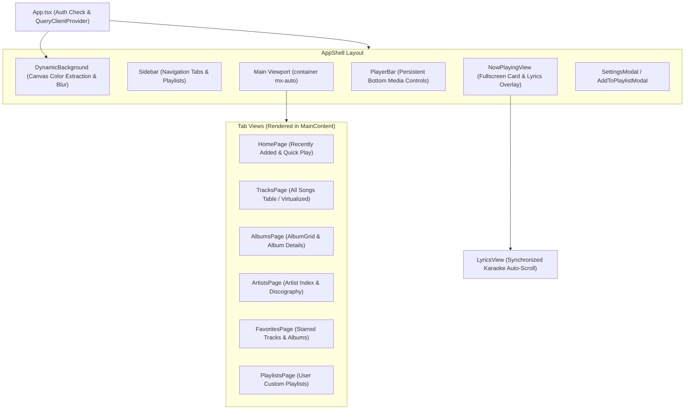
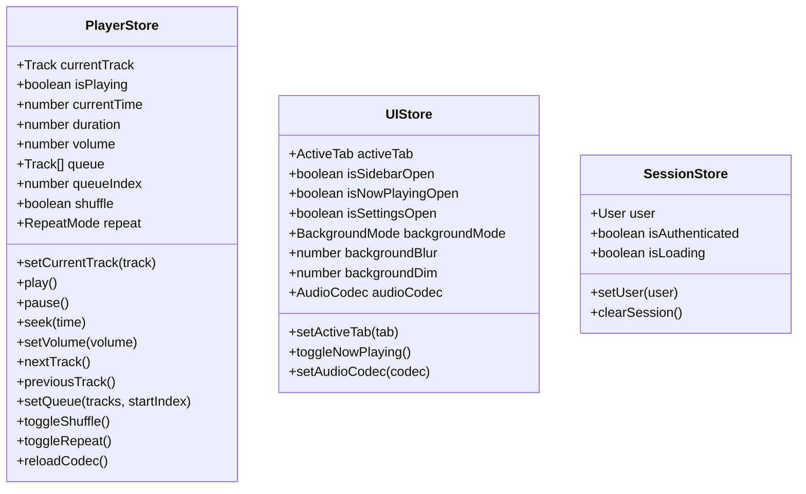
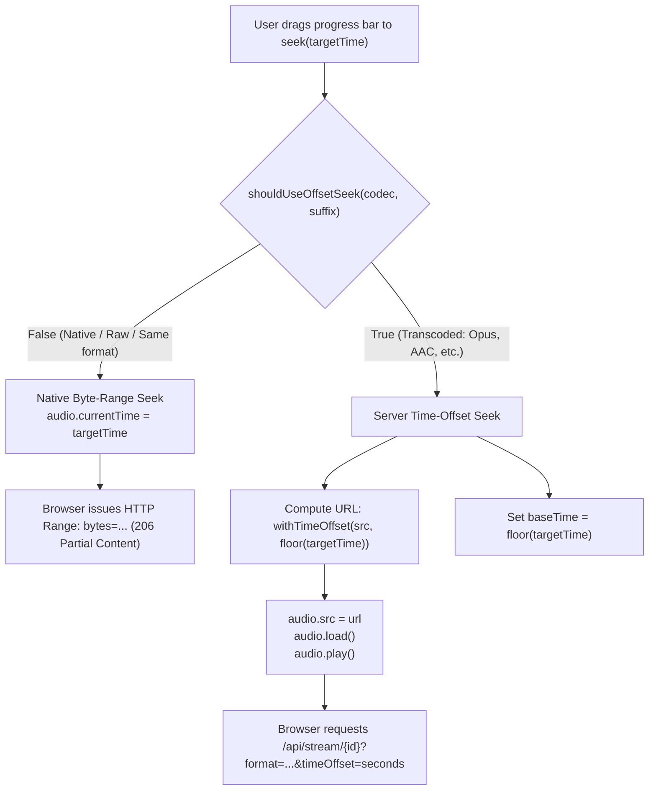

# Frontend Architecture & Audio Engine

This document provides a comprehensive technical overview of the **Core Music Player** frontend, including the component hierarchy, global state management, reactive audio engine, synchronized lyrics subsystem, and key UI interactions.

---

## 1. Frontend Overview & Tech Stack

The frontend is an Apple Music and macOS Glassmorphism-inspired Single-Page Application (SPA) built for real-time responsiveness and 60–120 FPS animations.

### Core Technologies
- **[React 19](https://react.dev/)**: Reactive UI layer using functional components and hooks.
- **[TypeScript](https://www.typescriptlang.org/)**: Strict type safety covering Subsonic payloads, player states, and UI preferences.
- **[Vite](https://vitejs.dev/)**: Next-generation frontend build tool and development server.
- **[Tailwind CSS](https://tailwindcss.com/)**: Utility-first CSS engine powering glassmorphic styling (`backdrop-blur-md`, subtle translucent borders, and dynamic gradients).
- **[Zustand](https://github.com/pmndrs/zustand)**: Lightweight, un-opinionated state management with localStorage persistence.
- **[TanStack Query v5](https://tanstack.com/query)**: Asynchronous server-state management, cache deduplication, and optimistic mutations.
- **[Lucide React](https://lucide.dev/)**: Clean icon set for media controls and navigation.

---

## 2. Component Hierarchy & Layout Structure

The application layout is structured around [`AppShell.tsx`](file:///Users/skenls/webplayer/frontend/src/components/layout/AppShell.tsx):



---

## 3. Global State Architecture (Zustand)

Global state is split across three domain-specific Zustand stores:



### 3.1 Player Store ([`playerStore.ts`](file:///Users/skenls/webplayer/frontend/src/store/playerStore.ts))
Controls the playback queue, current song, volume, and playback status:
- **`setCurrentTrack(track: Track)`**:
  1. Sets `currentTrack`, initializes `duration = track.duration`, and resets `currentTime = 0`.
  2. Resolves streaming URL and seek mode via `getStreamSource(track)`.
  3. Dispatches audio configuration to `audioService.setSrc(source.url, { offsetSeek })`.
- **`toggleShuffle()`**:
  - When enabled: Preserves the current sequence in `originalQueue`, retains the currently playing song at index 0, and shuffles the remaining queue items using the Fisher-Yates algorithm.
  - When disabled: Restores `queue` to match `originalQueue` seamlessly.
- **`toggleRepeat()`**:
  Cycles repeat state: `'off'` $\rightarrow$ `'all'` $\rightarrow$ `'one'` $\rightarrow$ `'off'`.
- **`reloadCodec()`**:
  Invoked when the user alters the active audio codec in Settings. Re-evaluates stream parameters, re-attaches audio source at the exact active timestamp (`startAt: currentTime`), and continues playback without restarting the track.

### 3.2 UI Store ([`uiStore.ts`](file:///Users/skenls/webplayer/frontend/src/store/uiStore.ts))
Manages persistent visual preferences and window toggles using Zustand's `persist` middleware (stored in browser `localStorage`):
- `activeTab`: Currently active sidebar tab (`'home' | 'favorites' | 'tracks' | 'artists' | 'albums' | 'playlists' | 'settings'`).
- `backgroundMode`: `'dynamic'` (extracted from album artwork) or `'custom'` (uploaded wallpaper).
- `backgroundBlur`: Integer blur radius in pixels (default: `24px`).
- `backgroundDim`: Integer overlay opacity percentage (default: `40%`).
- `audioCodec`: User preferred streaming format (`'mp3' | 'raw' | 'opus' | 'flac' | 'aac'`).
- `nowPlayingBackground`: Boolean switch enabling or disabling album wallpaper inside the fullscreen player.

### 3.3 Session Store ([`sessionStore.ts`](file:///Users/skenls/webplayer/frontend/src/store/sessionStore.ts))
Tracks the user's login session:
- `user`: Holds `{ id: string, username: string, role: 'admin' | 'user' }`.
- `isAuthenticated`: Boolean authorization status.
- `isLoading`: Initialized to `true` on page load while checking `/api/auth/me`.

---

## 4. Audio Pipeline & Stream Seek Engine

Web browsers natively encounter difficulties seeking inside on-the-fly transcoded audio containers (such as Opus in Ogg or AAC in ADTS) because standard container timestamps and keyframe byte tables are not present until the file is fully rendered.

Core Music Player resolves this using a **Dual-Mode Seek Engine** split across [`audioService.ts`](file:///Users/skenls/webplayer/frontend/src/lib/audioService.ts) and [`streamSeek.ts`](file:///Users/skenls/webplayer/frontend/src/lib/streamSeek.ts).



### 4.1 Offset Seek Detection Logic (`streamSeek.ts`)
```typescript
const SOURCE_CODECS: Record<string, string> = {
  mp3: 'mp3',
  flac: 'flac',
  ogg: 'opus',
  oga: 'opus',
  opus: 'opus',
  m4a: 'aac',
  mp4: 'aac',
  aac: 'aac',
};

export function shouldUseOffsetSeek(
  format: string | null | undefined,
  sourceSuffix: string | null | undefined,
): boolean {
  if (!format || format === 'raw') return false;
  const suffix = sourceSuffix?.toLowerCase();
  return !suffix || SOURCE_CODECS[suffix] !== format;
}
```
- If the track format is already `flac` and the user requests `format=flac`, `shouldUseOffsetSeek` evaluates to `false`. Seeking operates via native browser byte ranges.
- If a lossless FLAC or MP3 is transcoded to `opus` or `aac`, `shouldUseOffsetSeek` evaluates to `true`. Seeking triggers server-side keyframe seeking.

### 4.2 Time Representation in `AudioService`
When running in offset-seek mode, the browser's `audio.currentTime` resets to `0` whenever a new time-offset URL is loaded. `AudioService` normalizes this:
```typescript
getCurrentTime(): number {
  return absoluteTime(this.baseTime, this.audio.currentTime);
}

getDuration(): number {
  const duration = this.audio.duration;
  return Number.isFinite(duration) ? this.baseTime + duration : 0;
}
```
The rest of the application (progress sliders, lyrics synchronizer, MediaSession API) always receives continuous absolute timestamps.

---

## 5. Custom React Hooks

### 5.1 `useAudioEngine` ([`useAudioEngine.ts`](file:///Users/skenls/webplayer/frontend/src/hooks/useAudioEngine.ts))
Instantiates the `audioService` singleton and registers audio event listeners:
- **`timeupdate`**: Dispatches `updateProgress(audioService.getCurrentTime(), exactDuration)` to `playerStore`.
- **`ended`**: Evaluates repeat settings. If `repeat === 'one'`, executes `audioService.seek(0)` and resumes playback; otherwise dispatches `nextTrack()`.
- **`MediaSession API Integration`**:
  Configures native OS media controls (macOS Control Center, iOS Lock Screen, Windows Media overlay):
  - Sets track title, cleaned artist name, and album name.
  - Registers artwork in 96x96, 256x256, and 512x512 resolutions pointing to `/api/stream/cover/{coverArt}?size=...`.
  - Maps OS actions: `play`, `pause`, `previoustrack`, `nexttrack`, and `seekto`.

### 5.2 `useLyricsSync` ([`useLyricsSync.ts`](file:///Users/skenls/webplayer/frontend/src/hooks/useLyricsSync.ts))
Coordinates synchronized lyric line highlighting:
- Subscribes to `currentTime` from `playerStore`.
- Evaluates the parsed LRC lines array using a reverse sweep to determine the active line index:
  $$\text{activeLine} = \max \{ i \mid \text{lines}[i].\text{time} \le \text{currentTime} \}$$
- Provides `seekToLine(index)` allowing the user to click any lyric line to jump playback directly to that timestamp.

### 5.3 `useKeyboardShortcuts` ([`useKeyboardShortcuts.ts`](file:///Users/skenls/webplayer/frontend/src/hooks/useKeyboardShortcuts.ts))
Captures global keypresses (ignoring inputs, textareas, and contenteditable elements):
- `Space`: Toggle Play/Pause.
- `ArrowLeft`: Seek backward 5 seconds (`seek(currentTime - 5)`).
- `ArrowRight`: Seek forward 5 seconds (`seek(currentTime + 5)`).
- `KeyF`: Toggle fullscreen Now Playing / Lyrics modal.
- `Escape`: Close modals and exit fullscreen Now Playing view.

### 5.4 `useFavorites` ([`useFavorites.ts`](file:///Users/skenls/webplayer/frontend/src/hooks/useFavorites.ts))
Manages favoriting and unfavoriting using TanStack Query:
- Fetches favorited item IDs via `api.library.getFavoriteIds()`.
- Provides `toggleFavorite(id, type)` with optimistic cache updates, instantly flipping the heart icon before network acknowledgment.

---

## 6. Key UI Views & Components

### 6.1 Dynamic Background ([`DynamicBackground.tsx`](file:///Users/skenls/webplayer/frontend/src/components/background/DynamicBackground.tsx))
Generates ambient artwork backgrounds:
- Pulls current cover art image URL from `currentTrack.coverArt`.
- In `dynamic` mode: Renders image with CSS filter `blur({backgroundBlur}px)` and brightness reduction `brightness({100 - backgroundDim}%)`.
- Uses cross-fading opacity transitions (`transition-opacity duration-700`) to smoothly transition between track artwork changes without flickering.
- In `custom` mode: Displays the custom wallpaper uploaded via Settings.

### 6.2 Now Playing & Lyrics ([`NowPlayingView.tsx`](file:///Users/skenls/webplayer/frontend/src/components/nowplaying/NowPlayingView.tsx))
An immersive, full-screen playback environment:
- Left pane: High-resolution album artwork with spring-physics drop-shadows and track metadata.
- Right pane: Karaoke lyrics view rendered by [`LyricsView.tsx`](file:///Users/skenls/webplayer/frontend/src/components/nowplaying/LyricsView.tsx).
- Auto-scrolls the active lyric line to vertical center with smooth CSS animation.
- Detects manual user scroll and suspends auto-scrolling temporarily, displaying a "Sync" button to snap back to the current line.

---

## 7. Key Frontend Methods & Invocations Reference

| Module / Store | Function / Method | Signature | Description |
| :--- | :--- | :--- | :--- |
| **`usePlayerStore`** | `setCurrentTrack` | `(track: Track) => void` | Updates playing track, resets timer, and loads stream source in `audioService`. |
| **`usePlayerStore`** | `play` / `pause` | `() => void` | Controls playback state in store and triggers `audioService.play()` / `pause()`. |
| **`usePlayerStore`** | `seek` | `(time: number) => void` | Forwards seek request to `audioService.seek(time)`. |
| **`usePlayerStore`** | `setQueue` | `(tracks: Track[], startIndex?: number) => void` | Sets active playlist queue, sets start track, and saves `originalQueue`. |
| **`usePlayerStore`** | `toggleShuffle` | `() => void` | Shuffles queue while preserving current track at index 0 and storing original order. |
| **`usePlayerStore`** | `toggleRepeat` | `() => void` | Rotates repeat mode (`'off'` $\rightarrow$ `'all'` $\rightarrow$ `'one'`). |
| **`usePlayerStore`** | `reloadCodec` | `() => void` | Rebuilds stream URL with new codec and hot-reloads audio at current playback time. |
| **`audioService`** | `setSrc` | `(src: string, options?: LoadOptions) => void` | Configures `HTMLAudioElement.src` with optional base time and offset-seek flags. |
| **`audioService`** | `seek` | `(time: number) => void` | Native `currentTime` assignment or URL reload with `timeOffset`. |
| **`audioService`** | `getCurrentTime` | `() => number` | Returns `baseTime + audio.currentTime`. |
| **`audioService`** | `getDuration` | `() => number` | Returns `baseTime + audio.duration`. |
| **`streamSeek`** | `shouldUseOffsetSeek` | `(format?: string, suffix?: string) => boolean` | Determines if seeking requires server `timeOffset` transcode reloading. |
| **`streamSeek`** | `withTimeOffset` | `(src: string, seconds: number) => string` | Returns URL with updated `?timeOffset=...` parameter. |
| **`useLyricsSync`** | `seekToLine` | `(index: number) => void` | Seeks playback to the timestamp of the clicked lyrics line. |
| **`libraryApi`** | `getAlbums` | `(type?, size?, all?) => Promise<Album[]>` | Queries backend albums with batch-pagination support. |
| **`libraryApi`** | `getTracks` | `(all?, size?, offset?) => Promise<Track[]>` | Queries backend tracks across the entire library. |
| **`lyricsApi`** | `getLyrics` | `(trackId: string) => Promise<LyricsResponse>` | Retrieves synchronized LRC lyrics with dual-TTL caching. |
| **`authApi`** | `login` | `(credentials) => Promise<User>` | Authenticates against `/api/auth/login` and sets session cookie. |
| **`authApi`** | `logout` | `() => Promise<void>` | Clears session cookie and resets session store state. |

## Synapse

Home starts with the large `components/synapse/SynapseSection.tsx` panel; existing library sections follow it. Familiarity chips combine and moods toggle exclusively. Track rows display server reasons and start the entire Synapse mix at the selected index. CSS sphere/wave animations run while Synapse is playing, pause offscreen/in hidden tabs and obey `prefers-reduced-motion`.

`api/synapse.ts`, `store/synapseStore.ts`, and `hooks/useSynapseMix.ts` own the authenticated mix and persisted filters. `AppShell` mounts telemetry and continuation once, with a global notification. Queue session metadata is additive: the stream URL, codec and seeking API are unchanged. `queueEnded` and a queue generation counter prevent stale auto-continue responses from replacing a newer queue. Continue playback defaults off in audio settings. Telemetry uses elapsed listening time rather than seek position, buffers UUID events per user and retries deliveries. Reset clears that user's learned profile while keeping favorites.

See [synapse-usage.md](synapse-usage.md) for usage, rollback baseline and verification limits.
